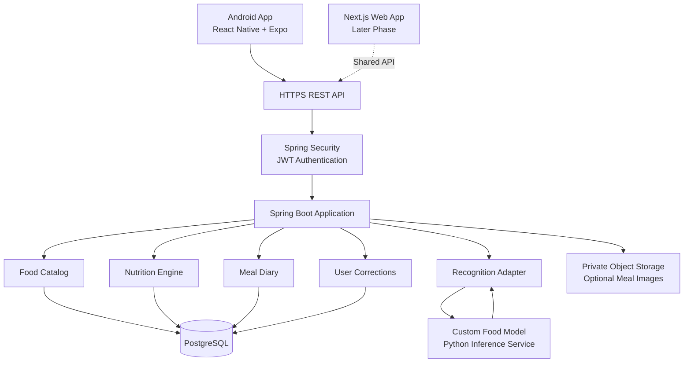

# 🍎 FitTrack AI

### AI-Powered Food Recognition & Smart Nutrition Tracking

<p align="center">
  
</p>

<p align="center">
  <strong>📸 Food Recognition · 🥗 Nutrition Analytics · 🇮🇳 Indian Food Intelligence · 📱 Android First</strong>
</p>

<p align="center">
  
  
  
  
  
</p>

<p align="center">
  <a href="#-overview">Overview</a> •
  <a href="#-features">Features</a> •
  <a href="#-architecture">Architecture</a> •
  <a href="#-getting-started">Setup</a> •
  <a href="#-machine-learning">Machine Learning</a> •
  <a href="#-roadmap">Roadmap</a>
</p>

---

## ✨ Overview

**FitTrack AI** is an Android-first nutrition tracking platform designed to help people understand the food they eat through photo-assisted food identification, nutrition estimation, meal logging, and personalized dietary analytics.

The product is designed with Indian cuisine in mind, including South Indian meals, regional recipes, mixed dishes, and everyday foods that are not always represented well in generic food datasets.

Users can photograph a meal, review the predicted food items, correct portion estimates, inspect nutrition information, and save a confirmed entry to their food diary.

FitTrack AI separates AI-based food recognition from nutrition calculation. Food predictions are matched against documented food records and recipes instead of allowing a language model to invent nutritional values.

### 🎯 Vision

Build a practical, transparent, and trustworthy nutrition application that combines custom food recognition, reliable nutrition data, user-controlled corrections, and accessible mobile experiences.

### 💡 Core principles

- **User-controlled:** Review and correct AI suggestions before saving.
- **Nutrition-aware:** Track calories, protein, carbohydrates, fats, and available additional nutrients.
- **Indian-food focused:** Support regional dishes through a documented food catalog and evaluation dataset.
- **Transparent:** Explain estimates, assumptions, and nutrition sources.
- **Privacy-first:** Protect meal photos, personal information, and nutrition history.
- **Evidence-driven:** Publish model evaluation results only after actual testing.

> ⚠️ **Development status:** This README describes the intended architecture and product scope. Features, model accuracy, automated tests, and deployment status must be updated to reflect the actual repository and verified results.

---

## 🚀 Features

### 📸 1. AI Food Recognition

- Capture a meal using the Android camera or select a photo.
- Submit the image for custom food-model inference.
- Display candidate food labels and available confidence information.
- Support multi-item meal analysis when the selected model implements it.
- Allow manual food search when recognition fails.
- Preserve model version and analysis provenance.

**Important:** A photo does not reveal exact food weight, hidden oil, all ingredients, or the precise recipe. Recognition results are estimates, not laboratory measurements.

### 🥗 2. Nutrition Calculation

Track available nutrients such as:

| Nutrient | Purpose |
|---|---|
| Calories | Estimate energy intake |
| Protein | Track protein consumption |
| Carbohydrates | Track carbohydrate intake |
| Total fat | Track fat intake |
| Fiber | Track dietary fiber when available |
| Sugar | Track sugar when available |
| Sodium | Track sodium when available |

Nutrient values should come from documented food-composition records or ingredient-based recipe calculations. Missing values must remain unknown rather than being treated as zero.

### 🇮🇳 3. Indian Food Intelligence

The planned food catalog includes categories such as:

- Idli, dosa, pongal, upma, and uttapam.
- Sambar, rasam, chutneys, kootu, and poriyal.
- Rice dishes, curd rice, biryani, and pulao.
- Chapati, roti, parotta, and curries.
- Dal, legumes, vegetables, eggs, fish, chicken, and paneer.
- Fruits, beverages, snacks, sweets, and packaged foods.

Regional coverage depends on the actual catalog and evaluation dataset. Food names, preparation methods, and nutrition values should be verified rather than assumed.

### ✏️ 4. User Corrections

AI predictions are suggestions, not final records.

Users should be able to:

- Change the identified food.
- Remove incorrect detections.
- Add missing food items.
- Adjust serving size or weight.
- Review updated nutrition totals.
- Confirm the meal before saving.

Corrections should be stored with sufficient provenance to reproduce the resulting nutrition calculation.

### 📊 5. Nutrition Dashboard

Planned dashboard capabilities:

- Daily calorie and macronutrient summaries.
- Meal history and food diary.
- Progress against user-defined nutrition goals.
- Weekly and monthly trends.
- Nutrient breakdown by meal.
- Clear empty, loading, and error states.

### 🎙️ 6. Tamil and Tanglish Food Logging

Planned voice logging supports natural food-entry workflows, subject to speech-recognition quality.

Example:

> “Inniku morning rendu idli, oru cup sambar saapten.”

The application should display the transcription and proposed food entries for review. Ambiguous food names and quantities must be clarified before saving.

### 🛒 7. Budget Nutrition

Planned tools include:

- Cost per serving.
- Cost per gram of protein.
- Ingredient-based recipe costing.
- Grocery-list generation.
- Budget-based food comparisons.

These calculations require real price inputs or documented price sources. Do not assume prices are current without verification.

### 🔐 8. Privacy and Security

The intended design includes:

- Spring Security authentication.
- Backend-managed JWT access and refresh-token lifecycle.
- User-specific data authorization.
- Private photo storage.
- Request validation and rate limiting.
- Secure secret management.
- Data export and account-deletion workflows.

Actual security depends on implementation, configuration, testing, and deployment.

---

## 🛠️ Technology Stack

| Component | Technology |
|---|---|
| Android application | React Native, Expo, TypeScript |
| Mobile navigation | Expo Router |
| Backend language | Java 21 LTS |
| Backend framework | Compatible Spring Boot 3.x |
| API security | Spring Security, JWT |
| ORM and persistence | Spring Data JPA, Hibernate |
| Database | PostgreSQL |
| Database migrations | Flyway |
| API documentation | OpenAPI |
| ML development | Python, PyTorch or an evaluated alternative |
| Nutrition data | Licensed food-composition records and curated Indian-food data |
| Web application — later | Next.js, TypeScript, Tailwind CSS |
| Backend testing | JUnit 5, Mockito, Testcontainers |
| Mobile testing | TypeScript checks, component tests, end-to-end tests |
| Local infrastructure | Docker, Docker Compose |
| CI/CD | GitHub Actions or the repository's configured CI platform |

Versions and dependency compatibility should be checked against the actual project configuration before installation.

---

## 🏗️ Architecture



### Architecture responsibilities

**Android application**
- Handles camera access, photo selection, meal editing, and nutrition visualization.
- Communicates with the backend through documented APIs.
- Maintains local drafts where offline support is implemented.

**Java backend**
- Authenticates users and enforces authorization.
- Manages food records, nutrition calculations, and meal history.
- Validates model requests and persists user corrections.
- Coordinates access to the ML service and private photo storage.

**Custom ML component**
- Predicts food labels and supported visual information.
- Returns versioned predictions and confidence values.
- Does not independently decide a user's authoritative nutrition record.

**PostgreSQL**
- Stores user accounts, food records, meals, nutrition provenance, and corrections.

**Web application**
- Will use the same backend contracts in a later development phase.

---

## 📂 Project Structure

```text
fittrack-ai/
├── apps/
│   ├── android/
│   │   ├── app/
│   │   ├── src/
│   │   ├── components/
│   │   ├── features/
│   │   ├── services/
│   │   └── tests/
│   └── web/                         # Later phase
├── backend/
│   ├── pom.xml
│   └── src/
│       ├── main/
│       │   ├── java/com/fittrack/
│       │   │   ├── auth/
│       │   │   ├── security/
│       │   │   ├── user/
│       │   │   ├── food/
│       │   │   ├── recognition/
│       │   │   ├── nutrition/
│       │   │   ├── recipe/
│       │   │   ├── meal/
│       │   │   ├── budget/
│       │   │   ├── report/
│       │   │   └── privacy/
│       │   └── resources/
│       │       └── db/migration/
│       └── test/
├── ml/
│   ├── configs/
│   ├── datasets/
│   ├── src/
│   ├── scripts/
│   ├── tests/
│   └── reports/
├── infra/
│   ├── docker/
│   ├── compose/
│   └── deployment/
├── docs/
│   ├── architecture/
│   ├── api/
│   ├── security/
│   ├── privacy/
│   ├── testing/
│   └── deployment/
├── .github/workflows/
├── .env.example
├── .gitignore
└── README.md
```

This is the target structure, not a claim that every directory or module already exists.

---

## ⚙️ Getting Started

### Prerequisites

Install the tools needed for your development environment:

- Java 21 JDK.
- Maven, or use the project's Maven Wrapper.
- Node.js LTS compatible with the selected Expo SDK.
- npm.
- Android Studio and a configured Android SDK.
- PostgreSQL, or Docker with Docker Compose.
- Python and the selected ML framework for model development.
- Git.

Verify your installed tools:

```bash
java -version
node --version
npm --version
git --version
```

If a Maven Wrapper exists:

```bash
./mvnw -version
```

On Windows Command Prompt:

```bat
mvnw.cmd -version
```

### 1. Clone the repository

Replace the placeholder with the actual repository URL.

```bash
git clone <YOUR_GITHUB_REPOSITORY_URL>
cd fittrack-ai
```

### 2. Configure environment variables

Create a local environment configuration based on `.env.example`, if that file exists.

Example configuration keys:

```dotenv
SPRING_PROFILES_ACTIVE=local
SERVER_PORT=8080

DB_URL=jdbc:postgresql://localhost:5432/fittrack
DB_USERNAME=fittrack_app
DB_PASSWORD=<LOCAL_DATABASE_PASSWORD>

JWT_ISSUER=fittrack-ai
JWT_ACCESS_TOKEN_TTL_SECONDS=900

FOOD_MODEL_BASE_URL=http://localhost:8000
FOOD_MODEL_VERSION=<MODEL_VERSION>

PHOTO_STORAGE_MODE=local
```

These are example configuration names, not a guarantee that the current application already reads them. Align them with the actual Spring configuration.

Generate and store signing keys securely. Never commit actual passwords, private keys, production credentials, or tokens.

### 3. Start PostgreSQL

If the repository includes a working Compose configuration:

```bash
docker compose up -d postgres
```

Otherwise, configure PostgreSQL independently and create the database and restricted application user.

Verify the connection before starting the backend. Production schema changes should use Flyway migrations, not automatic schema generation.

### 4. Run the Java backend

From the backend directory:

```bash
cd backend
```

Linux or macOS:

```bash
./mvnw spring-boot:run
```

Windows:

```bat
mvnw.cmd spring-boot:run
```

If the Maven Wrapper is unavailable and Maven is installed:

```bash
mvn spring-boot:run
```

The default local API URL may be `http://localhost:8080`, depending on configuration.

### 5. Run the Android application

From the Android application directory:

```bash
cd apps/android
npm install
npx expo start
```

Use the Expo CLI workflow supported by the project's installed SDK. Run the app in an Android emulator or a compatible physical device.

**Important networking note:** `localhost` on an Android emulator or physical phone refers to that device, not necessarily your development computer. Configure the correct reachable backend address for the environment.

### 6. Run the ML pipeline

Follow the actual environment and dataset instructions under `ml/`.

A typical training workflow will include:

1. Install the pinned ML dependencies.
2. Validate the dataset manifest and licensing information.
3. Check image integrity and class labels.
4. Generate reproducible train/validation/test splits.
5. Train the model.
6. Evaluate the held-out test set.
7. Save model artifacts and the evaluation report.
8. Configure the backend's inference adapter.
9. Verify the integration using real inference responses.

Do not mark the model as trained or available until these steps have actually succeeded.

---

## 🔌 API Overview

The following endpoints define the planned API surface. Only endpoints present and tested in the repository should be described as implemented.

| Method | Endpoint | Purpose |
|---|---|---|
| POST | `/api/v1/auth/register` | Register a user |
| POST | `/api/v1/auth/login` | Authenticate a user |
| POST | `/api/v1/auth/refresh` | Refresh an access token |
| POST | `/api/v1/auth/logout` | Revoke a session or refresh token |
| GET | `/api/v1/users/me` | Retrieve the current profile |
| PATCH | `/api/v1/users/me` | Update the profile |
| GET | `/api/v1/food/search` | Search food records |
| POST | `/api/v1/food/analyze` | Submit a photo for analysis |
| POST | `/api/v1/meals` | Save a confirmed meal |
| GET | `/api/v1/meals/daily` | Retrieve daily meal entries |
| PATCH | `/api/v1/meals/{mealId}` | Update a meal |
| DELETE | `/api/v1/meals/{mealId}` | Delete a meal |
| GET | `/api/v1/nutrition/summary` | Retrieve nutrition totals |
| PUT | `/api/v1/nutrition/goals` | Update nutrition goals |
| GET | `/api/v1/reports/weekly` | Retrieve weekly reports |
| POST | `/api/v1/recipes/calculate` | Calculate recipe nutrition |

All endpoints must validate inputs and enforce resource ownership. Recognition requests should have file-size limits, processing timeouts, rate limits, and clearly defined error behavior.

---

## 🧠 Machine Learning

### Training goals

The custom food model should be evaluated on a representative dataset that includes the foods and conditions it is intended to support.

The ML evaluation report should include:

- Dataset provenance and license.
- Class distribution and held-out sample count.
- Top-1 and top-5 classification accuracy.
- Per-class precision, recall, and F1 score.
- Macro-F1 and confusion matrix.
- Inference latency and model size.
- Performance limitations and confidence reliability.
- Model version and reproducibility details.

Use a separate held-out test set. Avoid duplicate or near-duplicate leakage between training and testing.

### Model limitations

A food classifier is not automatically a portion estimator or a nutrition database. Mixed dishes, overlapping foods, lighting, camera angle, regional preparation differences, and hidden ingredients can affect predictions.

FitTrack AI should allow corrections and communicate uncertainty. Accuracy claims should only be published when supported by measured results.

---

## 🧪 Testing and Quality

### Backend

```bash
cd backend
./mvnw test
```

Windows:

```bat
mvnw.cmd test
```

### Android

Run the scripts actually defined in the project's `package.json`. Typical checks may include:

```bash
npm run typecheck
npm test
```

These commands require matching scripts to exist. Do not treat a missing script as a passing check.

### ML

Run the dataset validation, inference tests, and evaluation scripts documented under `ml/`.

### Critical test scenarios

- Invalid credentials and expired tokens.
- Cross-user meal access.
- Malformed or oversized image uploads.
- Recognition-service failure.
- Food correction and nutrition recalculation.
- Recipe calculation and missing nutrient values.
- Duplicate meal submissions.
- Offline draft synchronization.
- Data export and account deletion.
- PostgreSQL migration and recovery behavior.

Record which tests ran, which passed, and which remain blocked.

---

## 🔐 Security and Privacy

FitTrack AI is intended to protect user accounts, meal records, and uploaded images.

Security requirements include:

- Signed and validated JWTs.
- Revocable refresh-token sessions.
- Secure password hashing.
- Server-side authorization.
- Private image storage.
- Input validation and rate limiting.
- HTTPS in deployed environments.
- Secret management outside Git.
- Restricted database privileges.
- Dependency and vulnerability scanning.
- Safe logging and error responses.

Privacy requirements include:

- Clear photo-retention policies.
- No model-training use of user images without explicit consent.
- Data export and account-deletion workflows.
- Defined retention and deletion behavior.
- Minimal collection of unnecessary personal information.

These are implementation requirements, not proof that the application is already secure or compliant.

---

## 📦 Deployment

### Android

Use the release workflow appropriate to the selected Expo SDK and Android build configuration. Configure application identifiers, signing credentials, environment settings, permissions, and release versioning.

Build and test a release artifact before distributing it. Do not publish an APK or Play Store link until the artifact has been generated and the release process has succeeded.

### Backend

Deploy the Spring Boot application to an appropriate managed or container-based environment.

Configure:

- Production PostgreSQL.
- Managed secrets.
- HTTPS.
- Private object storage.
- Health checks.
- Logging and error reporting.
- Backups and restore testing.
- Migration and rollback procedures.
- Capacity limits and rate limiting.

### Web — later phase

Deploy the Next.js application after the shared API contracts and Android workflows are stable. Keep the nutrition engine and authorization rules in the backend rather than duplicating them in the web client.

---

## 🗺️ Roadmap

- [ ] Repository audit and architecture documentation.
- [ ] Spring Boot project foundation.
- [ ] PostgreSQL schema and Flyway migrations.
- [ ] Secure registration and authentication.
- [ ] Indian-food catalog and nutrition engine.
- [ ] Custom food dataset and reproducible training pipeline.
- [ ] Held-out model evaluation.
- [ ] Android camera and photo-upload workflow.
- [ ] Food review and portion correction.
- [ ] Confirmed meal logging and daily diary.
- [ ] Nutrition dashboard and history.
- [ ] Privacy export and account deletion.
- [ ] Offline drafts and synchronization.
- [ ] Tamil/Tanglish voice logging.
- [ ] Budget and grocery tools.
- [ ] CI/CD and deployment verification.
- [ ] Next.js web application.

Update this checklist as work is completed and verified. Do not mark tasks complete simply because a design, prompt, or source file exists.

---

## 📈 Project Status

Keep this section synchronized with the actual implementation.

| Area | Status |
|---|---|
| Product specification | Defined in project requirements |
| Android application | Verify repository |
| Java backend | Verify repository |
| PostgreSQL migrations | Verify repository |
| Custom model training | Verify dataset and training results |
| Model evaluation | Requires actual evaluation report |
| Security testing | Requires test evidence |
| Automated CI/CD | Verify configured pipeline |
| Production deployment | Requires deployment evidence |
| Web application | Planned for a later phase |

### Suggested release gates

Before calling an MVP release-ready, verify that:

1. A user can authenticate and log a meal.
2. Food and portion corrections recalculate nutrition correctly.
3. Meal data is isolated by user authorization.
4. Database migrations and critical automated tests pass.
5. The actual custom model has a documented evaluation report.
6. Photo handling and data-deletion behavior have been tested.
7. A release build and deployment procedure have been verified.
8. Known limitations are documented.

---

## 🤝 Contributing

Contributions should preserve correctness, user privacy, maintainability, and nutrition-data provenance.

Suggested workflow:

1. Create a focused feature branch.
2. Document the expected behavior.
3. Implement the smallest complete change.
4. Add or update tests.
5. Run the relevant checks.
6. Open a pull request with test evidence and known limitations.

Do not submit private user photos, secrets, licensed datasets without permission, or unverified model-accuracy claims.

---

## ⚠️ Disclaimer

FitTrack AI provides food identification and nutrition estimates for informational purposes. Values may vary with serving size, ingredients, cooking method, and the quality of the underlying food data.

It is not a substitute for professional medical or dietetic advice. Users with medical nutrition requirements should consult a qualified professional.

---

## 📄 License

Choose and add an explicit project license before distributing the source code. Confirm that third-party datasets, model weights, libraries, and assets permit the intended use. Do not claim a license has been selected until the corresponding license file is present.

---

<p align="center">
  
  <strong>🥗 FitTrack AI — Make Every Meal More Informed.</strong>
</p>
